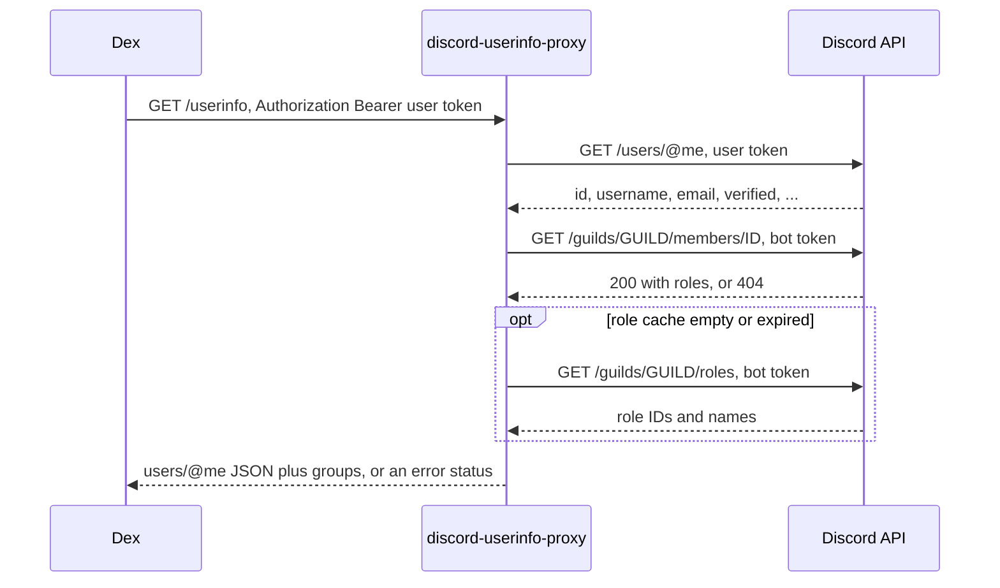

# discord-userinfo-proxy

A userinfo endpoint for [Dex's generic `oauth` connector](https://dexidp.io/docs/connectors/oauth/) that gates login on membership of one Discord server and turns that server's roles into a `groups` claim.

Dex has no Discord connector, and Discord's `/users/@me` response carries no roles. Reading a member's roles needs either the `guilds.members.read` user scope, which covers all of a user's servers and cannot be limited to one, or a bot token. This proxy uses the bot token, so users are only asked for `identify` and `email`.

## How it works



The response is the `/users/@me` object as modeled by discordgo's `User` type, plus a `groups` array. `groups` is `[]` for a member holding no eligible role.

### Known limitation: the user object is re-marshaled

The user is decoded into `discordgo.User` and encoded again, not forwarded byte for byte. Compared with the raw Discord response:

- A `null` or absent field becomes its zero value: `"global_name": null` becomes `""`, an absent `email` becomes `""`, and absent booleans and numbers become `false` and `0`.
- Fields that discordgo does not model are dropped.
- Fields Discord never sent, such as `token`, `banner` and `accent_color`, appear with zero values.

If logins break or claims look wrong after a Dex or Discord change, check this first. Typical symptoms are an empty user name when `userNameKey: global_name` is set and the user has no global name, an empty `email`, or a claim that Dex expects but the proxy no longer sends.

To restore the old behavior, make `CurrentUser` in `internal/discord/client.go` return the raw `/users/@me` body as `map[string]json.RawMessage` (fetched with `Session.RequestWithBucketID`), and set `groups` on that map in `internal/server/handler.go`.

## Groups

Every role the member holds becomes a group named after the role, with no mapping to maintain. `@everyone` and managed roles (bot, integration and booster roles) are never emitted. Names are lowercased, and roles whose names are equal after lowercasing, such as `Editors` and `editors`, become one group.

The role list is fetched from Discord on the first login and cached for `DISCORD_ROLE_CACHE_TTL` (default `5m`), which is also the longest a rename takes to show up. A role the cache does not know, such as one created after the last fetch, triggers an early refetch, at most once per 10 s. If the list cannot be fetched and the cache is empty or expired, the login fails with 500 instead of using old names.

Run this only if everyone who can create or assign roles in the Discord server is someone you would also trust as an administrator of every application behind Dex. See the security notes.

## Failure behaviour

The proxy fails closed. It never answers 200 with empty groups because of an error.

| Situation | Status |
|---|---|
| No or empty bearer token | 403 |
| Discord rejects the user's token | 403 |
| User is not a member of the guild | 403 |
| `/users/@me` fails, is rate limited or malformed | 500 |
| Member lookup fails, is rate limited or malformed | 500 |
| Role list cannot be fetched and the cache is empty or expired | 500 |

Responses carry a status code and an empty body. The specific reason is written to the server log only, so clients cannot use the response to tell failure causes apart beyond "not allowed" versus "server error".

Dex turns any non-200 userinfo response into a failed login. A Discord outage or a wrong bot token therefore blocks new logins. Existing sessions are unaffected.

Requests go through [discordgo](https://github.com/bwmarrin/discordgo), configured to fail fast: no retry on 429 or 502, and a 5 s HTTP timeout. A 200 member response without a `roles` field is accepted as a member with no groups.

One discordgo behaviour is not configurable: the shared bot session's rate limiter waits before sending when Discord has reported the member-lookup bucket as exhausted. That wait ignores the request context, so in that case a login can be delayed until the bucket resets.

## Configuration

Settings are command line flags. A flag that is not given falls back to the environment variable named after it in upper case with dashes as underscores, so `--discord-bot-token` is `DISCORD_BOT_TOKEN`. Prefer the environment for the bot token, since flags show up in the process list.

| Flag | Environment variable | Required | Description |
|---|---|---|---|
| `--discord-bot-token` | `DISCORD_BOT_TOKEN` | yes | Bot token, without the `Bot ` prefix |
| `--discord-guild-id` | `DISCORD_GUILD_ID` | yes | Numeric ID of the one guild whose members may log in |
| `--discord-role-cache-ttl` | `DISCORD_ROLE_CACHE_TTL` | no | Go duration, default `5m`. How long the role list is cached, see [Groups](#groups). Must be positive. |
| `--listen-addr` | `LISTEN_ADDR` | no | Default `:8080` |
| `--version` | | no | Print the version and exit |

Any invalid value makes the process exit at startup.

Endpoints: `GET /userinfo` and `GET /healthz`. The health check makes no Discord call, so a Discord outage does not restart the pod.

## Discord setup

1. Add a bot to your application in the Developer Portal and invite it to the server with the `bot` scope and no permissions.
2. Copy the guild ID with Developer Mode (right-click the server, Copy ID).
3. Enable the Server Members privileged intent if the member lookup returns 403 without it. Listing members requires it.

## Dex connector

Keep the usual Discord OAuth settings and change only the userinfo URL and the groups key:

```yaml
connectors:
  - type: oauth
    id: discord
    name: Discord
    config:
      clientID: $DISCORD_CLIENT_ID
      clientSecret: $DISCORD_CLIENT_SECRET
      redirectURI: https://dex.example.com/callback
      authorizationURL: https://discord.com/oauth2/authorize
      tokenURL: https://discord.com/api/oauth2/token
      userInfoURL: http://discord-userinfo-proxy.dex.svc.cluster.local:8080/userinfo
      scopes: [identify, email]
      userIDKey: id
      claimMapping:
        userNameKey: global_name
        preferredUsernameKey: username
        emailKey: email
        emailVerifiedKey: verified
        groupsKey: groups
```

Clients must request the `groups` scope to receive the claim.

## Security notes

- Do not expose the proxy outside the cluster. It trusts whatever bearer token it is given only to the extent Discord validates it, but it holds the bot token and is meant to be reachable from Dex alone. Restrict it with a NetworkPolicy.
- The bot token can read the member list of the guild. Give the bot no permissions beyond membership.
- The Discord server decides what groups exist. Anyone with Manage Roles can create a role named like a group an application trusts, such as `admin`, give it to themselves and log in with it. Renaming a role also changes the group name, which silently breaks authorization rules that match on it. Only run this proxy if Discord role managers are already trusted as application admins.
- Release images carry a build provenance attestation:

  ```bash
  gh attestation verify oci://ghcr.io/xonvanetta/discord-userinfo-proxy:<tag> --owner xonvanetta
  ```

  Pin the image by digest in your deployment.

## Development

```bash
make test    # unit tests with the race detector
make lint    # gofmt and go vet
make vuln    # govulncheck
make image TAG=v0.1.0
```

The only direct dependency is discordgo. It pins old versions of `gorilla/websocket` and `golang.org/x/crypto`, so `go.mod` raises their minimums. `make vuln` runs in CI.
## License

MIT
